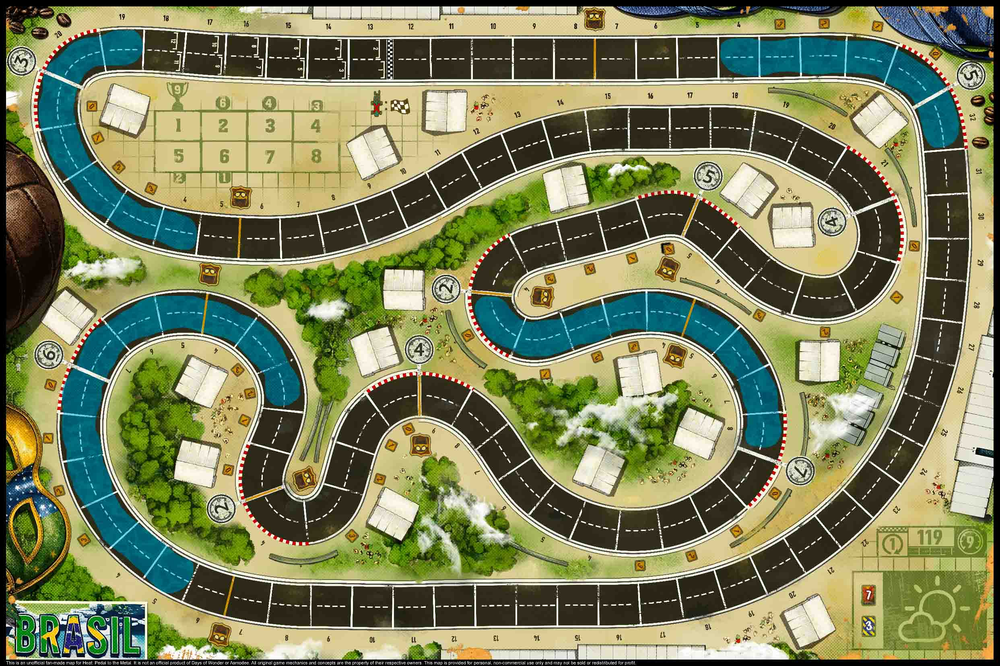
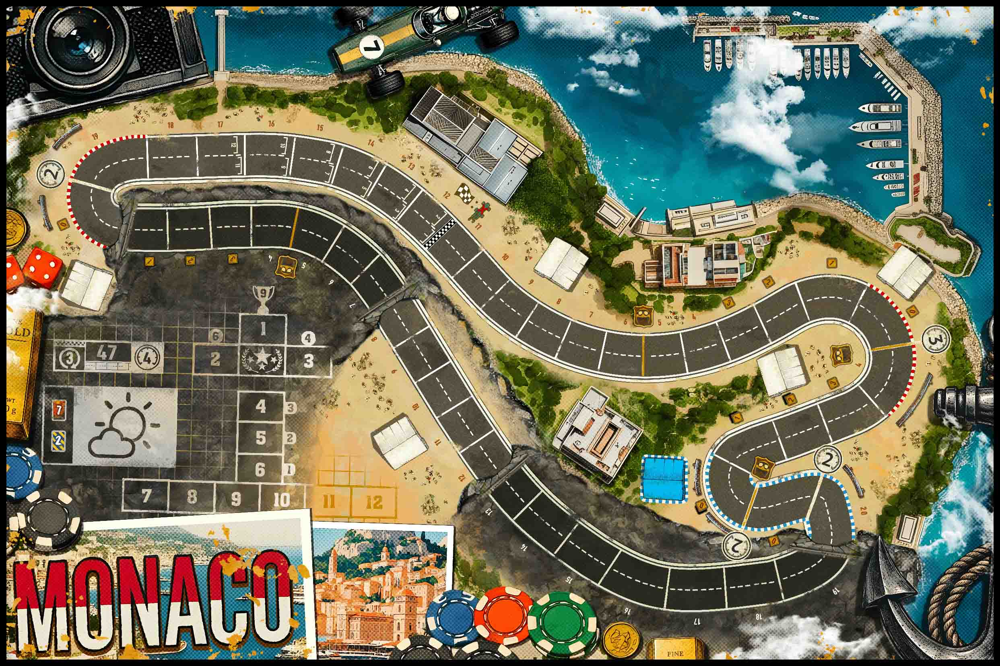
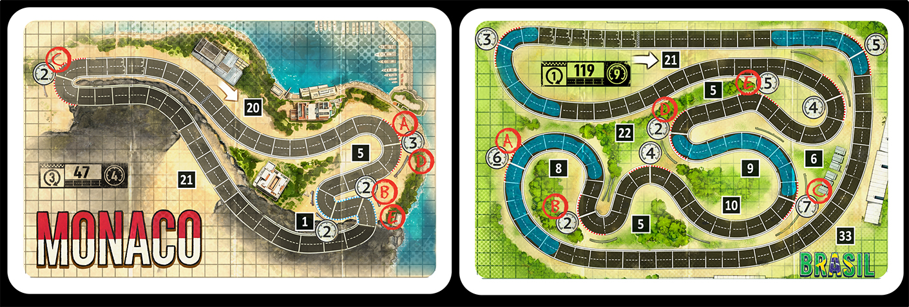

# heat_fan_tracks


# Fan Tracks for Heat: Pedal to the Metal

Unofficial fan-made tracks for the board game *Heat: Pedal to the Metal*.

They are playtested with both Legends and human players (up to 12 cars).

## Tracks
- Brazil GP (featuring rain puddles)
- DOWNLOAD HERE: https://github.com/Average-User-of-Yours/heat_fan_tracks/releases/download/v1.0/brasil_fan_map.pdf



- Monaco GP (featuring tunnels)
- DOWNLOAD HERE: https://github.com/Average-User-of-Yours/heat_fan_tracks/releases/download/v1.0/monaco_fan_map.pdf



## Track cards
- DOWNLOAD HERE: https://github.com/Average-User-of-Yours/heat_fan_tracks/releases/download/v1.0/monaco_brasil_cards.pdf



## Printing
Print at 100% scale on A4 paper.

## Disclaimer
This is an unofficial fan project for personal and community use ONLY!  
Heat: Pedal to the Metal is published by Days of Wonder / Asmodee.

# 📢 Map Development Update

Several new and updated maps are currently being worked on to improve the gameplay experience. Here is what is in progress:

- Monaco (Rework) – The map is being rebuilt for a better gameplay experience, while also incorporating the upcoming narrow streets expansion mechanic.

- Morocco (Brand New) – A completely new map is being developed, featuring the rocky roads expansion mechanics.

- Portugal (Brand New) – A brand new map is being built around the narrow street mechanics.

## Repo structure
```text
heat-fan-tracks/
│
├─ preview/
│   ├─ brazil_preview.jpg
│   ├─ monaco_preview.jpg
│   └─ monaco_brasil_cards_preview.jpg
│
└─ README.md
```
